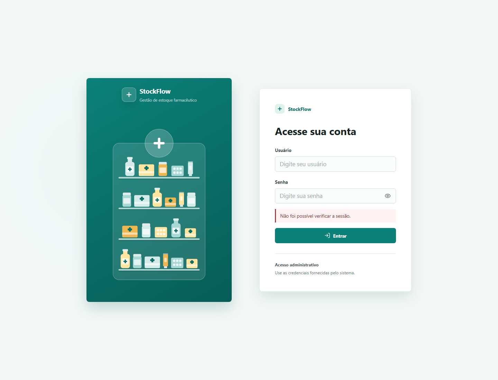
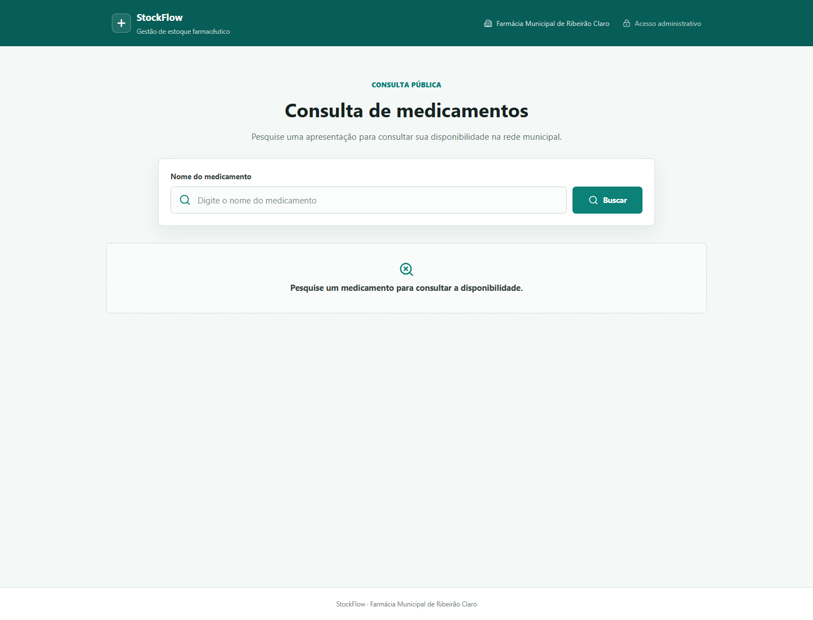

# Manual do Usuário — StockFlow

O StockFlow auxilia a organização, conferência e consulta do estoque de medicamentos importado dos relatórios CSV do G-MUS.

Este manual descreve o uso da versão atual do sistema. Os nomes dos menus podem variar levemente conforme a implantação, mas os fluxos principais permanecem os mesmos.

## 1. Acessos

O sistema possui dois contextos:

- **Administrativo:** exige uma conta Django ativa com `is_staff=True`.
- **Público:** permite consultar medicamentos sem login.

O usuário não deve compartilhar senha nem salvar credenciais em arquivos do projeto. A administração de contas é feita pelo fluxo autorizado de usuários administrativos/Django Admin, conforme a configuração da instalação.

## 2. Entrar no sistema

1. Abra a tela de login.
2. Informe usuário e senha.
3. Clique em **Entrar**.
4. Em caso de sucesso, o sistema abre o módulo administrativo.

Usuários inativos, não autorizados ou com credenciais inválidas recebem uma mensagem genérica. A sessão usa autenticação e cookies do Django.

> A captura mostra a composição visual da tela de login. Mensagens de sessão podem aparecer quando o backend local está desligado; isso não substitui a validação das credenciais.

## 3. Visão geral

Em **Visão geral**, o sistema resume a competência mais recente e o estado das importações.

Use esta tela para:

- verificar a competência completa mais recente;
- conferir quantas UPS participantes foram importadas;
- consultar totais de medicamentos e registros;
- acessar rapidamente **Importações**, **Validação** e **Análise**;
- observar o status de cada UPS.

Os indicadores de análise não devem ser interpretados como dados novos: eles são derivados dos relatórios e das regras documentadas.

## 4. Importar relatórios

Acesse **Importações**. A tela atual aceita dois tipos:

- **Consulta de Estoque (saldo total):** representa o saldo observado por medicamento e UPS.
- **Movimentações de Estoque (sintético):** representa entradas, saídas e demais movimentos usados nas análises e na validação.

### 4.1 Envio

1. Selecione o tipo de relatório.
2. Escolha o arquivo `.csv` exportado pelo G-MUS.
3. Aguarde a prévia automática.
4. Confira o tipo identificado, competência, UPS e quantidade de registros.
5. Clique em **Enviar**.

O arquivo deve corresponder à competência e à UPS selecionadas no relatório. A sequência entre estoque e movimentações não é uma ordem obrigatória, mas, para análise e validação completas, os dois relatórios precisam existir para a mesma competência e UPS.

O sistema preserva a origem por UPS, identifica a competência e valida o conteúdo antes de persistir. Arquivos reais não devem ser incluídos no Git.

### 4.2 Reimportação

Quando já existe uma importação para a mesma combinação de competência, UPS e tipo de relatório, a tela solicita confirmação antes de substituir os dados daquela origem.

- Um arquivo diferente pode exigir confirmação de reimportação.
- O mesmo arquivo já processado é identificado pelo hash SHA-256.
- A substituição deve ser confirmada conscientemente, pois atualiza os registros da competência/UPS/tipo correspondente.
- Se a prévia apontar erro, não confirme o envio até corrigir ou exportar novamente o relatório.

### 4.3 Histórico

O histórico mostra nome do arquivo, tipo, competência, UPS, data e responsável. Use os filtros de mês, UPS e tipo para localizar uma importação.

Excluir uma importação remove os registros dependentes daquela carga conforme as regras do sistema. Confirme sempre a competência e a UPS antes de excluir.

## 5. Competências

Em **Competências**, consulte a situação mensal de cada UPS participante.

Uma competência é considerada completa quando há uma importação válida de inventário para todas as UPS configuradas com `participa_competencia=True`. Importações parciais não completam a competência. A tela mostra:

- competência mais recente completa;
- quantidade de competências completas;
- competências em acompanhamento;
- UPS esperadas, importadas e status.

Use os filtros de ano e situação. Abra uma competência para ver o detalhamento por UPS.

## 6. Medicamentos administrativos

Em **Medicamentos**, consulte as apresentações cadastradas a partir dos relatórios.

É possível:

- buscar por descrição ou código G-MUS;
- filtrar por categoria, tag, competência, UPS, unidade, situação e validação;
- ordenar a lista;
- selecionar medicamentos para comparação;
- abrir o detalhe de uma apresentação;
- classificar ou desclassificar medicamentos quando autorizado.

Cada código G-MUS representa uma apresentação própria. Não agrupe apresentações diferentes apenas porque possuem o mesmo nome.

O estoque total administrativo soma os registros das UPS participantes na competência completa selecionada. A distribuição por UPS mantém a origem dos dados. A regra de disponibilidade pública é diferente e usa o consolidado convencional conforme as regras de negócio.

### 6.1 Detalhe do medicamento

Clique no código ou na descrição para abrir o detalhe. A página apresenta dados cadastrais, classificações e a posição de estoque por UPS. O total administrativo é separado da distribuição por unidade.

### 6.2 Classificações

Use **Gerenciar classificações** para criar, editar, ativar ou desativar classificações permitidas. A classificação `MANIPULADO` é protegida pelas regras de disponibilidade e não deve ser renomeada ou desativada por um fluxo comum.

## 7. Análise de consumo

Em **Análise**, selecione:

- competência inicial e final;
- UPS;
- categoria;
- unidade;
- medicamento, opcionalmente.

Clique em **Analisar**. A tela apresenta, conforme os dados disponíveis:

- consumo total;
- média mensal;
- medicamentos com saída;
- maior consumo;
- evolução por competência;
- ranking de maiores saídas;
- curva ABC;
- cobertura estimada;
- medicamentos sem saída no período.

Os resultados de consumo usam as saídas reconhecidas dos relatórios sintéticos de movimentação. A tela não deve ser usada para inferir consumo real apenas pela diferença entre dois saldos quando as entradas e demais movimentações não estiverem disponíveis.

Na curva ABC, a classe A reúne os medicamentos com maior participação acumulada no consumo, B representa a faixa intermediária e C concentra os menores consumos. Os blocos e rankings podem ser expandidos ou recolhidos para facilitar a leitura.

## 8. Validação de estoque

Em **Validação**, escolha uma competência e uma UPS e clique em **Validar estoque**.

O sistema compara:

`estoque anterior + entradas - saídas = estoque final`

O resultado apresenta estoque anterior, entradas, saídas, saldo esperado, saldo observado e situação. Quando existir divergência, o detalhamento disponibiliza a ação **Corrigir**, que exige uma justificativa.

O detalhamento também mostra os totais reconhecidos por tipo de movimento e os itens que ficaram fora da conciliação individual.

## 9. Funcionários e acesso administrativo

Em **Funcionários**, somente superusuários podem cadastrar e administrar contas de operação.

O formulário exige senha com:

- pelo menos 8 caracteres;
- letra maiúscula;
- letra minúscula;
- número;
- caractere especial.

Contas podem ser ativadas ou desativadas. Usuários com histórico de importação devem ser desativados em vez de excluídos. Um usuário `is_staff=True` consegue operar o StockFlow, mas não precisa ser superusuário para usar o módulo administrativo.

## 10. Consulta pública

Acesse `/medicamentos` para consultar sem autenticação.

1. Digite parte do nome ou o código G-MUS.
2. Clique em **Buscar** ou pressione Enter.
3. Use o botão de limpar para voltar ao estado inicial.

A resposta pública mostra somente:

- código G-MUS;
- descrição/apresentação;
- unidade;
- disponibilidade.

Não são exibidos ao cidadão UPS, quantidades, lotes, validade, competência, importação, usuário ou classificações internas.

## 11. Mensagens e problemas comuns

### “A API está temporariamente indisponível”

Confirme se o backend Django está ativo, se o frontend aponta para a URL definida em `VITE_API_URL` e se a sessão ainda está válida.

### “Tipo de relatório não reconhecido”

Confira se o arquivo é o CSV correto exportado pelo G-MUS e se o tipo selecionado na tela corresponde ao relatório. Não renomeie apenas a extensão para tentar forçar a importação.

### Importação duplicada ou reimportação

Confira competência, UPS e tipo. A confirmação só deve ser feita quando a nova carga realmente substituir a anterior.

### Acesso negado

Faça login com usuário ativo e autorizado para o módulo administrativo. A consulta pública permanece acessível sem login.

## 12. Boas práticas

- Faça backup dos arquivos CSV fora do repositório.
- Confirme a UPS e a competência antes de enviar.
- Não compartilhe senhas.
- Não coloque credenciais em `.env.example`, commits ou screenshots.
- Após a importação, confira a competência, o histórico e a validação.
- Para o TG, use arquivos fictícios ou anonimizados nas demonstrações.

## 13. Rotas principais

| Área | Rota |
| --- | --- |
| Login | `/login` |
| Visão geral | `/admin` |
| Importações | `/admin/importacoes` |
| Medicamentos | `/admin/medicamentos` |
| Detalhe do medicamento | `/admin/medicamentos/:id` |
| Comparação | `/admin/medicamentos/comparar` |
| Competências | `/admin/competencias` |
| Análise | `/admin/analises` |
| Validação | `/admin/validacao` |
| Funcionários | `/admin/funcionarios` |
| Alterar senha | `/admin/minha-conta/senha` |
| Consulta pública | `/medicamentos` |

